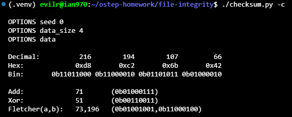
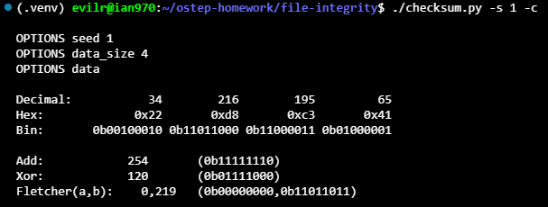
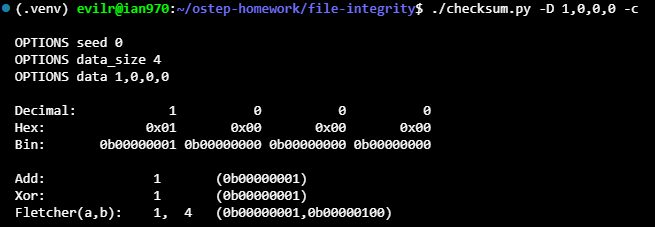
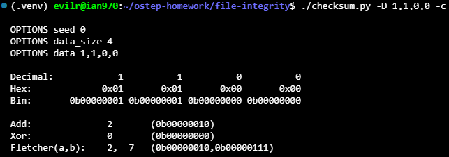
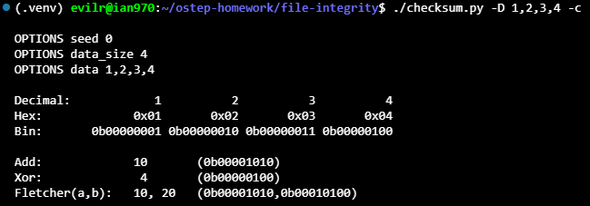
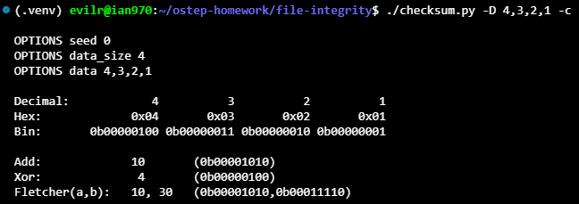
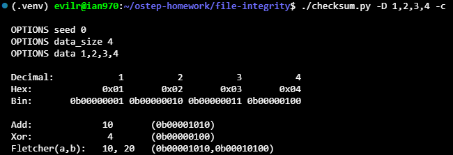
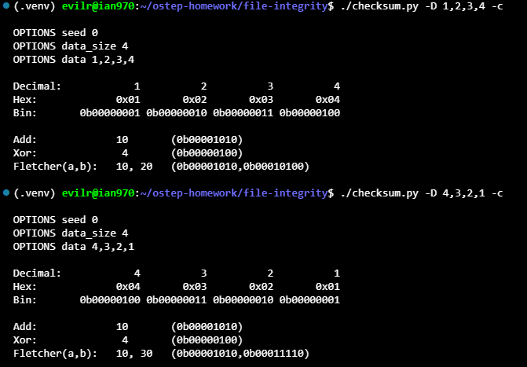
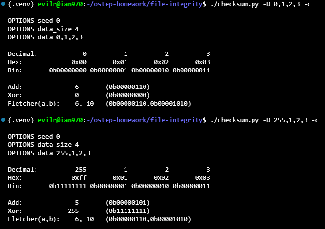

# Homework (Simulation)

In this homework, you’ll use checksum.py to investigate various aspects of checksums.

## Questions

1. First just run checksum.py with no arguments. Compute the additive, XOR-based, and Fletcher checksums. Use -c to check your answers.

    

   * **Objective**: Understand how the three fundamental checksum algorithms work on a default 4-byte dataset (`216, 194, 107, 66`) generated with seed `0`.

   * **Additive Checksum**: Sums all data bytes modulo 256.

   $$\sum \text{bytes} \pmod{256} = 583 \pmod{256} = 71$$

   * **XOR Checksum**: Performs a bitwise XOR across all bytes.

   $$216 \oplus 194 \oplus 107 \oplus 66 = 51$$

   * **Fletcher Checksum**: Maintains two running sums ($a$ and $b$) updated incrementally modulo 255 for each byte ($a = (a + d) \bmod 255$, $b = (b + a) \bmod 255$), producing a two-byte result `(73, 196)`.

2. Now do the same, but vary the seed (-s) to different values.

    

   * **Objective**: Evaluate how changing the random seed (`-s`) alters the generated byte sequence and affects checksum behavior.

   * **Input Data**: Using `-s 1`, the program produced `34, 216, 195, 65`.

   * **Additive Checksum**: Sums the values modulo 256:

   $$(34 + 216 + 195 + 65) \pmod{256} = 510 \pmod{256} = 254$$

   * **XOR Checksum**: Evaluates the parity across each bit position independently:

   $$34 \oplus 216 \oplus 195 \oplus 65 = 120$$

   * **Fletcher Checksum**: Demonstrates how modulo arithmetic resets running sums. Here, accumulator $a$ reached $255$, resetting cleanly to $0$ ($255 \bmod 255 = 0$), resulting in `(0, 219)`.

3. Sometimes the additive and XOR-based checksums produce the same checksum (e.g., if the data value is all zeroes). Can you pass in a 4-byte data value (using the -D flag, e.g., -D a,b,c,d) that does not contain only zeroes and leads the additive and XOR-based checksum having the same value? In general, when does this occur? Check that you are correct with the -c flag.

    

   * **Objective**: Find a non-zero 4-byte sequence where the additive checksum matches the XOR checksum, and determine when this occurs in general.
   * **Input Example**: `-D 1,0,0,0` resulted in `Add: 1` and `Xor: 1`.

   * **General Condition**: The additive checksum equals the XOR checksum if and only if **no carry bits are generated during addition** and the **total sum does not exceed 255** (avoiding modulo 256 wrap-around).

   * **Bitwise Explanation**: Arithmetic addition differs from XOR solely by carry propagation. When no two bytes share a `1` at the same bit position (i.e., bitwise mutually disjoint across all inputs), $\sum x_i = \bigoplus x_i$. A trivial case is having at most one non-zero byte in the sequence.

4. Now pass in a 4-byte value that you know will produce a different checksum values for additive and XOR. In general, when does this occur?

    

   * **Objective**: Provide a 4-byte input where the additive checksum diverges from the XOR checksum, and identify the general conditions causing this difference.

   * **Input Example**: `-D 1,1,0,0` produced `Add: 2` and `Xor: 0`.

   * **General Conditions for Divergence**:
   * **Carry Generation**: Addition propagates carries to higher bits ($1 + 1 = 10_2$), whereas XOR cancels identical bits ($1 \oplus 1 = 0$). Any dataset with two or more bytes sharing a `1` at the same bit position creates carry bits, resulting in differing sums.

   * **Modulo Wrap-Around**: Arithmetic addition wraps around at $256$ ($\sum x_i \ge 256$), which also disrupts any potential parity alignment between addition and XOR.

5. Use the simulator to compute checksums twice (once each for a different set of numbers). The two number strings should be different (e.g., -D a1,b1,c1,d1 the first time and -D a2,b2,c2,d2 the second) but should produce the same additive checksum. In general, when will the additive checksum be the same, even though the data values are different? Check your specific answer with the -c flag.

    

    

   * **Objective**: Execute the simulator twice with different data inputs to produce an identical additive checksum, and explain when this happens in general.
   * **Inputs & Results**:
   * Input 1: `-D 1,2,3,4` produced `Add: 10`.

   * Input 2: `-D 4,3,2,1` produced `Add: 10`.

   * **General Conditions for Additive Checksum Collisions**:
   * **Commutative Property (Permutation Invariance)**: Addition is commutative and associative. Reordering or swapping bytes preserves the total sum, making additive checksums blind to reordering.

   * **Modulo Congruence**: Any two datasets whose raw sums satisfy $\sum x_i \equiv \sum y_i \pmod{256}$ (differing by integer multiples of 256) map to the exact same additive checksum.

   * **Complementary Offsets**: Incrementing one byte by $k$ while decrementing another by $k$ leaves the sum unchanged.

6. Now do the same for the XOR checksum.

    

    * **Objective**: Identify conditions where distinct data sequences produce an identical XOR checksum.
    * **Inputs & Results**:
    * Input 1: `-D 1,2,3,4` resulted in `Xor: 4`.

    * Input 2: `-D 4,3,2,1` resulted in `Xor: 4`.

    * **General Conditions for XOR Checksum Collisions**:
    * **Commutative and Associative Properties**: Like addition, bitwise XOR is order-independent ($A \oplus B = B \oplus A$). Permuting byte positions leaves the output unchanged.

    * **Even-Parity Bit Invariance**: XOR functions as a per-bit parity check. Any modification that alters a bit position an even number of times across the dataset results in cancellation ($x \oplus x = 0$).

    * **Delta Cancellation**: Multiple byte changes that XOR-sum to zero ($\bigoplus \Delta x_i = 0$) will yield the exact same final checksum.

7. Now let’s look at a specific set of data values. The first is: -D 1,2,3,4. What will the different checksums (additive, XOR, Fletcher) be for this data? Now compare it to computing these checksums over -D 4,3,2,1. What do you notice about these three checksums? How does Fletcher compare to the other two? How is Fletcher generally “better” than something like the simple additive checksum?

    

    * **Objective**: Evaluate how Additive, XOR, and Fletcher checksums respond to byte reordering (permutation) by comparing `-D 1,2,3,4` against `-D 4,3,2,1`.

    * **Outputs**:
    * For `1,2,3,4`: `Add: 10`, `Xor: 4`, `Fletcher(a,b): 10, 20`

    * For `4,3,2,1`: `Add: 10`, `Xor: 4`, `Fletcher(a,b): 10, 30`

    * **Key Observations**:
    * **Additive and XOR Blindness**: Both Addition and XOR are commutative and associative, meaning reordered data yields identical checksums (`Add: 10`, `Xor: 4`). They cannot detect permutation errors.

    * **Position Sensitivity in Fletcher**: The second accumulator computes $b = \sum_{i=1}^{n} (n - i + 1) d_i \pmod{255}$, weighting earlier bytes more heavily. Reversing the byte order alters $b$ (from $20$ to $30$) while $a$ stays $10$, successfully flagging the rearrangement.

    * **Why Fletcher is Superior**:
    * **Position Awareness**: Detects reordered, swapped, or transposed data blocks that basic additive checksums miss.

    * **Broader State Space**: Fletcher-16 provides roughly $255 \times 255 \approx 65,025$ states compared to only $256$ states in an 8-bit additive sum, significantly reducing collision rates.

8. No checksum is perfect. Given a particular input of your choosing, can you find other data values that lead to the same Fletcher checksum? When, in general, does this occur? Start with a simple data string (e.g., -D 0,1,2,3) and see if you can replace one of those numbers but end up with the same Fletcher checksum. As always,
use -c to check your answers.

    

   * **Objective**: Demonstrate that Fletcher's checksum can encounter collisions by replacing a single byte in a simple data string (e.g., `-D 0,1,2,3`) while maintaining an identical checksum.

   * **Inputs & Collision**:
   * Input 1: `-D 0,1,2,3` produced `Fletcher(a,b): 6, 10`

   * Input 2: `-D 255,1,2,3` produced `Fletcher(a,b): 6, 10`

   * **General Conditions for Fletcher Collisions**:
   * **Modulo 255 Congruence ($0 \equiv 255$)**: Fletcher arithmetic uses modulo $255$ ($2^8 - 1$). Because $255 \equiv 0 \pmod{255}$, replacing any byte value $0$ with $255$ contributes $0$ modulo 255 to both accumulator $a$ and weighted accumulator $b$, producing an identical checksum.

   * **Simultaneous Linear Congruence**: More broadly across multi-byte changes, collisions occur whenever deltas $\Delta d_i$ satisfy both $\sum \Delta d_i \equiv 0 \pmod{255}$ and $\sum (n - i + 1)\Delta d_i \equiv 0 \pmod{255}$.
