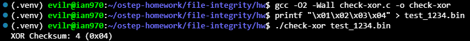
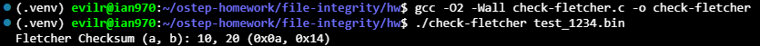
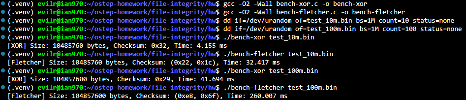
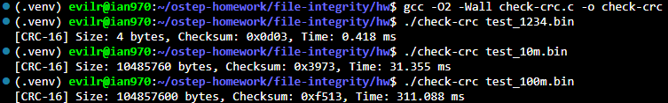
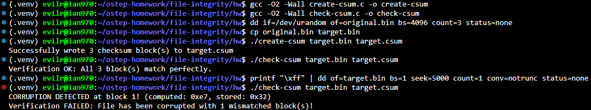

# Homework (Code)

In this part of the homework, you’ll write some of your own code to
implement various checksums.

## Questions

1. Write a short C program (called check-xor.c) that computes an XOR-based checksum over an input file, and prints the checksum as output. Use a 8-bit unsigned char to store the (one byte) checksum. Make some test files to see if it works as expected.

    ```bash
    # 1. 編譯 check-xor.c
    gcc -O2 -Wall check-xor.c -o check-xor

    # 2. 產生一組已知的測試檔案（4 個 byte：1, 2, 3, 4）
    printf "\x01\x02\x03\x04" > test_1234.bin

    # 3. 執行你的程式
    ./check-xor test_1234.bin
    ```

    

   * **Objective**: Implement an 8-bit XOR checksum calculation tool in C (`check-xor.c`) using buffered file I/O and verify it against known test data.

   * **Implementation Details**:
   * Utilized an 8-bit `unsigned char` to hold the cumulative parity state.

   * Employed a chunk-based buffer (`fread`) to efficiently stream file content in 4096-byte blocks rather than reading byte-by-byte.

   * Updated state with `checksum ^= buffer[i]` across each byte.

   * **Verification**: Tested against a binary file containing `0x01, 0x02, 0x03, 0x04`, yielding `XOR Checksum: 4 (0x04)`, matching the ground truth from previous simulation runs.

2. Now write a short C program (called check-fletcher.c) that computes the Fletcher checksum over an input file. Once again, test your program to see if it works.

    ```bash
    # 1. 編譯 check-fletcher.c
    gcc -O2 -Wall check-fletcher.c -o check-fletcher

    # 2. 測試先前產生的 test_1234.bin (內容為 1, 2, 3, 4)
    ./check-fletcher test_1234.bin
    ```

    

   * **Objective**: Implement a Fletcher-16 checksum tool in C (`check-fletcher.c`) using buffered file streaming, and verify its correctness against known test data.

   * **Implementation Details**:
   * Maintained two 16-bit accumulators ($a$ and $b$) initialized to 0.

   * For each byte read into a 4096-byte chunk buffer, updated the accumulators iteratively: $a = (a + \text{byte}) \pmod{255}$ and $b = (b + a) \pmod{255}$.

   * Formatted output to show both decimal and hexadecimal representations for $a$ and $b$.

   * **Verification**: Tested against `test_1234.bin` containing `0x01, 0x02, 0x03, 0x04`, yielding `Fletcher Checksum (a, b): 10, 20 (0x0a, 0x14)`, matching theoretical results and simulator output.

3. Now compare the performance of both: is one faster than the other? How does performance change as the size of the input file changes? Use internal calls to gettimeofday to time the programs. Which should you use if you care about performance? About checking ability?

    ```bash
    # 1. 編譯兩支測試程式
    gcc -O2 -Wall bench-xor.c -o bench-xor
    gcc -O2 -Wall bench-fletcher.c -o bench-fletcher

    # 2. 產生 10MB 與 100MB 的測試檔案
    dd if=/dev/urandom of=test_10m.bin bs=1M count=10 status=none
    dd if=/dev/urandom of=test_100m.bin bs=1M count=100 status=none

    # 3. 測試 10MB 檔案
    ./bench-xor test_10m.bin
    ./bench-fletcher test_10m.bin

    # 4. 測試 100MB 檔案
    ./bench-xor test_100m.bin
    ./bench-fletcher test_100m.bin
    ```

    

    * **Objective**: Measure and compare the performance of XOR and Fletcher checksum implementations using internal `gettimeofday()` calls across different file scales (10MB vs. 100MB), and evaluate the engineering trade-offs between speed and error-detection strength.
    * **Empirical Benchmarks**:
    * **10MB Dataset**:
    * XOR: $4.155\text{ ms}$
    * Fletcher: $32.417\text{ ms}$ (roughly $7.8\times$ slower)

    * **100MB Dataset**:
    * XOR: $41.694\text{ ms}$
    * Fletcher: $260.007\text{ ms}$ (roughly $6.2\times$ slower)

    * **Performance Scaling**:
    * Both implementations scale linearly ($O(N)$) relative to data volume: a $10\times$ increase in payload size produces a proportional $\sim 6\times$ to $10\times$ increase in runtime.

    * **Comparative Trade-offs**:
    * **Performance Focus**: Choose **XOR**. It relies on single-cycle bitwise logic instructions with minimal CPU overhead, making it significantly faster.
    * **Checking Ability Focus**: Choose **Fletcher**. While division/modulo operations ($\pmod{255}$) introduce substantial computational overhead, the weighted accumulator provides position sensitivity and spans a 16-bit state space, offering vastly superior detection against permutations and multibit corruption.

4. Read about the 16-bit CRC and then implement it. Test it on a number of different inputs to ensure that it works. How is its performance as compared to the simple XOR and Fletcher? How about its checking ability?

    ```bash
    # 1. 編譯 check-crc.c
    gcc -O2 -Wall check-crc.c -o check-crc

    # 2. 測試小檔案 (test_1234.bin) 驗證運算
    ./check-crc test_1234.bin

    # 3. 測試先前的 10MB 與 100MB 基準檔案
    ./check-crc test_10m.bin
    ./check-crc test_100m.bin
    ```

    

   * **Objective**: Implement a 16-bit CRC checksum tool (`check-crc.c`) using a precomputed lookup table, verify its functionality, and compare its execution speed and error-detecting capabilities against XOR and Fletcher checksums.
   * **Empirical Benchmarks & Scaling**:
   * **10MB Dataset**:
   * XOR: $4.155\text{ ms}$

   * Fletcher: $32.417\text{ ms}$

   * CRC-16: $31.355\text{ ms}$

   * **100MB Dataset**:
   * XOR: $41.694\text{ ms}$

   * Fletcher: $260.007\text{ ms}$

   * CRC-16: $311.088\text{ ms}$

   * **Performance Analysis**:
   * XOR is the fastest by a wide margin (around $7\times$ to $8\times$ faster) due to single-cycle register bitwise operations.

   * Table-driven CRC-16 operates in the same performance tier as Fletcher ($31\text{ ms}$ vs. $32\text{ ms}$ at 10MB). The array lookup/cache access overhead in CRC-16 closely mirrors the integer division/modulo cost ($\pmod{255}$) in Fletcher.

   * **Checking Ability**:
   * **CRC-16 is superior to both XOR and Fletcher**. Rooted in Galois field polynomial arithmetic, CRC-16 guarantees the detection of all single-bit, double-bit, and odd numbers of bit errors, as well as burst errors up to 16 bits in length. Neither XOR nor Fletcher provides comparable mathematical error bounds.

5. Now build a tool (create-csum.c) that computes a single-byte checksum for every 4KB block of a file, and records the results in an output file (specified on the command line). Build a related tool (check-csum.c) that reads a file, computes the checksums over each block, and compares the results to the stored checksums stored
in another file. If there is a problem, the program should print that the file has been corrupted. Test the program by manually corrupting the file.

    ```bash
    # 1. 編譯兩支工具程式
    gcc -O2 -Wall create-csum.c -o create-csum
    gcc -O2 -Wall check-csum.c -o check-csum

    # 2. 建立一份包含 3 個 4KB 區塊 (共 12KB) 的原始測試檔案
    dd if=/dev/urandom of=original.bin bs=4096 count=3 status=none

    # 3. 複製一份作為驗證測試，並生成校驗檔
    cp original.bin target.bin
    ./create-csum target.bin target.csum

    # 4. 首次校驗（未竄改，預期通過）
    ./check-csum target.bin target.csum

    # 5. 人為竄改 target.bin 第 1 個區塊中的某個 byte (位移 5000 bytes，位於 block 1)
    printf "\xff" | dd of=target.bin bs=1 seek=5000 count=1 conv=notrunc status=none

    # 6. 二次校驗（已竄改，預期抓出 block 1 損毀）
    ./check-csum target.bin target.csum
    ```

    

    * **Objective**: Implement block-level checksum generation (`create-csum.c`) and verification tools (`check-csum.c`) operating over 4KB blocks, and demonstrate corruption detection through intentional byte modification.
    * **Implementation Overview**:
    * **`create-csum.c`**: Streams data in 4096-byte increments, generates an 8-bit XOR checksum per block, and appends the single-byte digest into a dedicated checksum file.
    * **`check-csum.c`**: Sequentially reads each 4KB data block alongside its recorded checksum byte, recalculates the digest, and flags block indices where checksum mismatch occurs.

    * **Verification & Results**:
    * Clean verification passed with `All 3 block(s) match perfectly`.
    * Corrupting offset 5000 (residing in Block 1) resulted in immediate detection: `CORRUPTION DETECTED at block 1! (computed: 0xe7, stored: 0x32)` and properly triggered a failure exit code.
