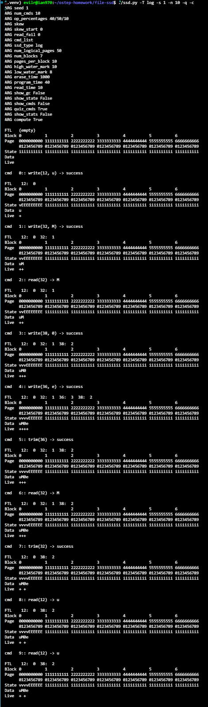
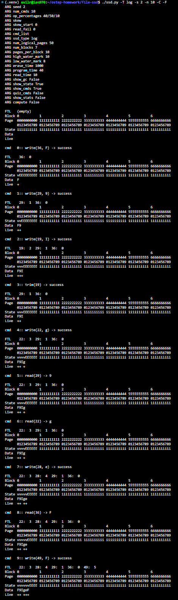
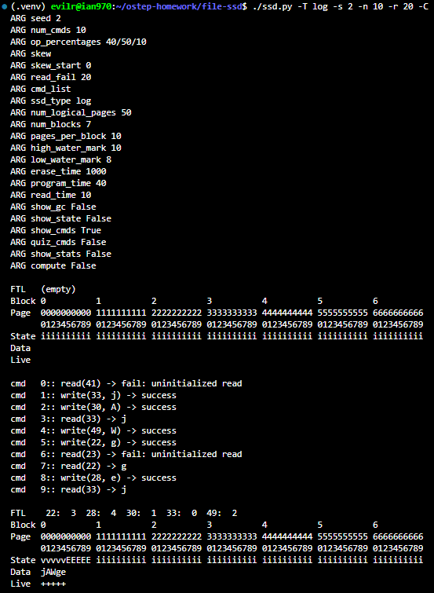
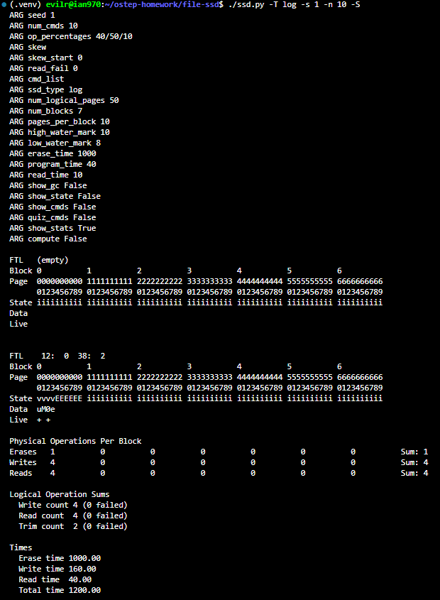
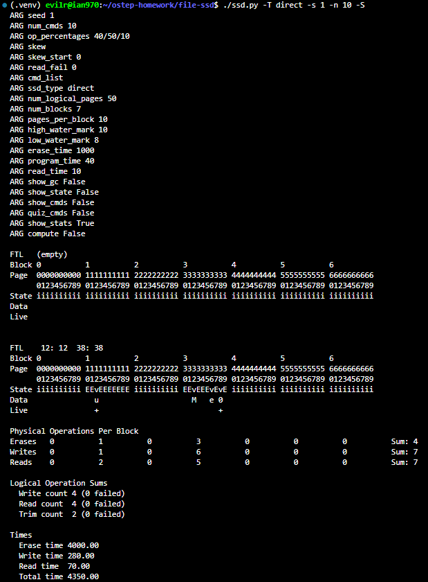
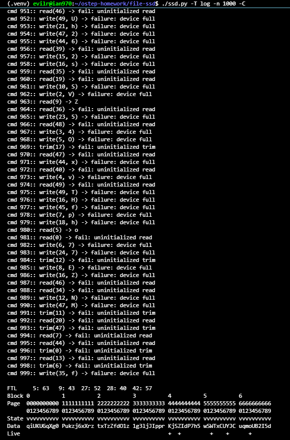
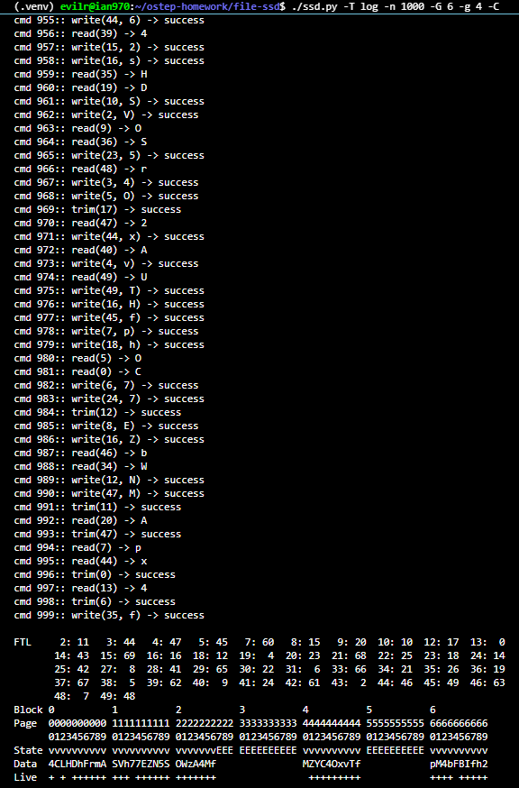
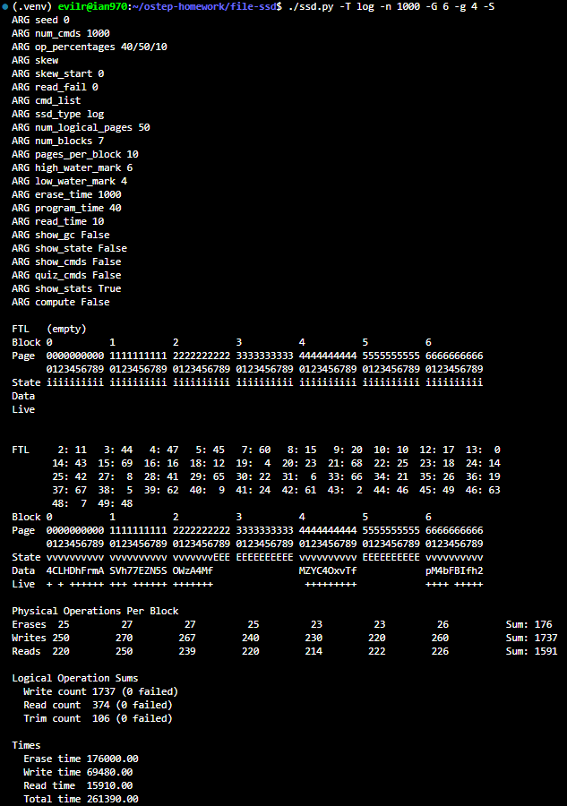
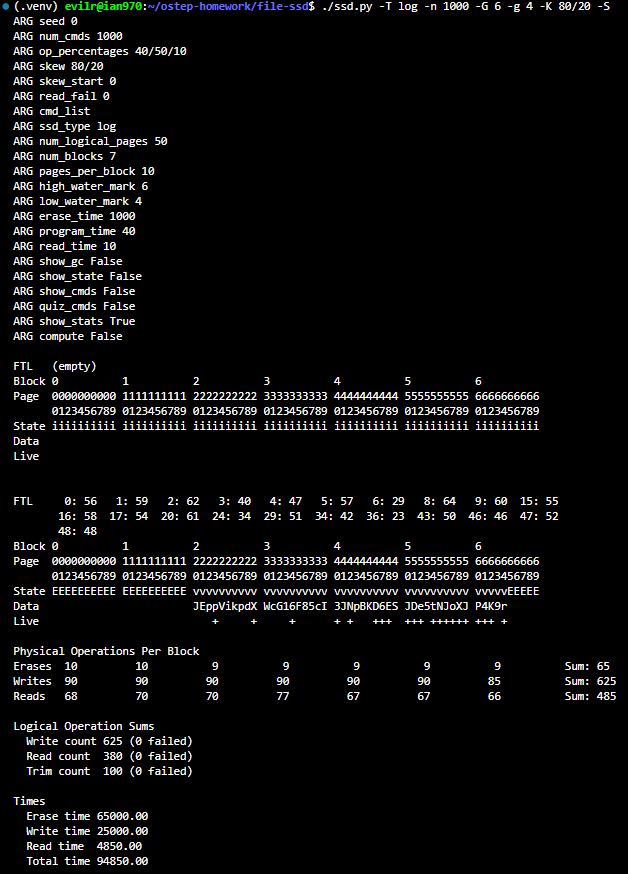

# Homework (Simulation)

This section introduces ssd.py, a simple SSD simulator you can use to understand better how SSDs work. Read the README for details on how to run the simulator. It is a long README, so boil a cup of tea (caffeinated likely necessary), put on your reading glasses, let the cat curl up on your lap1
, and get to work.

## Questions

1. The homework will mostly focus on the log-structured SSD, which is simulated with the “-T log” flag. We’ll use the other types of SSDs for comparison. First, run with flags -T log -s 1 -n 10 -q. Can you figure out which operations took place? Use -c to check your answers (or just use -C instead of -q -c). Use different values of -s to generate different random workloads.

    

   * **Log-Structured Writes (Append-only)**: When writing to a new block, the log-structured SSD first erases the target block (transitioning its pages to the erased state `E`), and subsequently appends writes sequentially into the next available physical pages (marked as valid `v`).

   * **FTL Mapping**: The Flash Translation Layer (FTL) updates dynamically on every write, mapping the logical page requested by the application to the physical page where the data was appended (e.g., logical page 12 mapped to physical page 0).

   * **Trim Operations & Data Invalidation**: Executing a `trim` does not immediately erase physical flash memory; instead, it removes the address mapping from the FTL and drops the liveness status (clearing the `+` mark), rendering the physical page stale until garbage collection occurs.

   * **Read Idempotence**: Read operations perform table lookups via the FTL to retrieve data from the corresponding physical page, leaving Flash states, data contents, and liveness unchanged.

2. Now just show the commands and see if you can figure out the intermediate states of the Flash. Run with flags -T log -s 2 -n 10 -C to show each command. Now, determine the state of the Flash between each command; use -F to show the states and see if you were right. Use different random seeds to test your burgeoning expertise.

    

   * **Predictable Append-Only State Progression**: Each write systematically allocates the next sequential physical page within the active block, advancing the internal write pointer without overwriting previous locations.

   * **Trim Mechanism and Dead Pages**: The `trim` command unmaps the logical address from the FTL, transitioning the underlying physical page to an invalid/dead state (clearing the `+` under `Live`) while retaining physical page validity `v` and old data until reclamation.

   * **FTL Decoupling**: Logical addresses are decoupled from physical locations, allowing non-sequential logical writes to be placed compactly into contiguous physical pages (e.g., logical 36, 29, 19, 22, 28, 49 mapped to physical pages 0 through 5).

   * **Read Invariance**: Reading data inspects the FTL and physical storage directly, leaving physical page states, data content, and liveness masks completely unaffected.

3. Let’s make this problem ever so slightly more interesting by adding the -r 20 flag. What differences does this cause in the commands? Use -c again to check your answers.

    

   * **Uninitialized Read Handling**: Setting the `-r 20` flag instructs the workload generator to issue approximately 20% of read operations to random addresses without verifying whether they contain valid data.

   * **Read Failures**: When an address that has not been written (or has been trimmed) is queried, the FTL lookup detects an unmapped address and reports `fail: uninitialized read`.

   * **Workload Sequence Divergence**: Because reads are allowed to target unmapped addresses, the generator no longer skips read instructions when fewer than two valid addresses exist, shifting the pseudo-random generator stream and altering subsequent commands.

4. Performance is determined by the number of erases, programs, and reads (we assume here that trims are free). Run the same workload again as above, but without showing any intermediate states (e.g., -T log -s 1 -n 10). Can you estimate how long this workload will take to complete? (default erase time is 1000 microseconds, program time is 40, and read time is 10) Use the -S flag to check your answer. You can also change the erase, program, and read times with the -E, -W, -R flags.

    

   * **Performance Model Breakdown**: Total simulated execution latency is calculated from the cumulative physical operations: $\text{Total Time} = (N_{\text{erase}} \times T_{\text{erase}}) + (N_{\text{write}} \times T_{\text{program}}) + (N_{\text{read}} \times T_{\text{read}})$.

   * **Dominance of Erase Latency**: Block erases are by far the most expensive operation ($1000\ \mu\text{s}$ vs. $40\ \mu\text{s}$ for program and $10\ \mu\text{s}$ for read). In this specific run, a single erase operation contributed over 83% of the total execution time ($1000\ \mu\text{s}$ out of $1200\ \mu\text{s}$).

   * **Trim Performance Cost**: The `trim` operation is modeled as a purely logical metadata operation incurring no physical erase, program, or read cost directly on the Flash media at issuance time.

5. Now, compare performance of the log-structured approach and the (very bad) direct approach (-T direct instead of -T log). First, estimate how you think the direct approach will perform, then check your answer with the -S flag. In general, how much better will the log-structured approach perform than the direct one?

    

    * **Read-Modify-Write Penalty in Direct Mapping**: Because Flash memory cannot overwrite valid pages in place, the direct-mapped approach (`-T direct`) forces a full block read-modify-write cycle for updates: reading existing live pages within the block, erasing the block, and reprogramming both old live data and incoming data.

    * **Write and Read Amplification**: Updating adjacent pages within the same block amplifies internal I/O operations. For 4 logical writes, the direct approach incurred 7 physical reads and 7 physical writes.

    * **Performance Degradation Due to Erases**: Erase latency ($1000\ \mu\text{s}$) heavily penalizes the direct approach. In this workload, 4 erases resulted in $4000\ \mu\text{s}$ of erase latency alone, making total runtime $4350.00\ \mu\text{s}$ compared to $1200.00\ \mu\text{s}$ under the log-structured approach (a ~3.6x slowdown).

    * **Architectural Advantage of Logging**: The log-structured design amortizes erase costs across entire blocks by buffering sequential page writes into empty erased blocks, avoiding per-write block erasures.

6. Let us next explore the behavior of the garbage collector. To do so, we have to set the high (-G) and low (-g) watermarks appropriately. First, let’s observe what happens when you run a larger workload to the log-structured SSD but without any garbage collection. To do this, run with flags -T log -n 1000 (the high wa-termark default is 10, so the GC won’t run in this configuration).What do you think will happen? Use -C and perhaps -F to see.

    

   * **Space Exhaustion without Garbage Collection**: In a log-structured SSD with append-only writes, available blocks eventually become filled with a mix of live and obsolete (dead) pages.

   * **High Watermark Inaccessibility**: By default, the high watermark is set to 10 (`-G 10`) while the physical device only has 7 blocks (`-B 7`). Consequently, the trigger condition (`blocks_in_use >= high_water_mark`) is never satisfied, completely disabling garbage collection.

   * **Write Failures (`failure: device full`)**: Once all 7 blocks (70 physical pages) are programmed, subsequent write commands fail immediately with `failure: device full`.

   * **Necessity of GC**: Even though the SSD has ample logical space remaining (as only a handful of pages remain marked with `+` in the `Live` row), writes cannot proceed without GC reclaiming blocks containing obsolete data.

7. To turn on the garbage collector, use lower values. The high watermark (-G N) tells the system to start collecting once N blocks have been used; the low watermark (-g M) tells the system to stop collecting once there are only M blocks in use. What watermark values do you think will make for a working system? Use -C and -F to show the commands and intermediate device states and see.

    

    * **Watermark Configuration for Sustained Operation**: To prevent write stalls and device-full conditions in a finite physical SSD ($B = 7$), the high watermark $G$ must be strictly less than or equal to total blocks ($G \le 7$), and the low watermark $g$ must be configured lower than $G$ ($g < G$).

    * **Autonomous Space Reclamation**: By setting `-G 6 -g 4`, the GC automatically triggers once 6 physical blocks are occupied, cleaning and erasing victim blocks until only 4 blocks remain in active use.

    * **Zero Failure Execution**: With appropriate watermark boundaries, obsolete data generated across 1000 random operations is continuously reclaimed, allowing all 1000 commands to complete with `success`.

    * **Free Block Pool Maintenance**: Reclaimed blocks are kept in an erased state (`EEEEEEEEEE`), providing pre-erased target blocks for forthcoming append-only writes.

8. One other useful flag is -J, which shows what the collector is doing when it runs. Run with flags -T log -n 1000 -C -J to see both the commands and the GC behavior. What do you notice about the GC? The final effect of GC, of course, is performance. Use -S to look at final statistics; how many extra reads and writes occur due to garbage collection? Compare this to the ideal SSD (-T ideal); how much extra reading, writing, and erasing is there due to the nature of Flash? Compare it also to the direct approach; in what way (erases, reads, programs) is the log-structured approach superior?

    

    * **Garbage Collection Overhead (Write/Read Amplification)**: To reclaim free blocks, the GC must identify live pages in victim blocks, read them into memory, and reprogram them into the active write block before erasing. Across the 1000-command workload, this resulted in 1217 extra physical reads ($1591 - 374$) and 1217 extra physical writes, yielding a significant Write Amplification Factor (WAF $\approx 3.34$).

    * **Comparison with Ideal SSD (`-T ideal`)**: An ideal SSD performs direct byte-level modifications with zero erase cycles ($N_{\text{erase}} = 0$) and zero garbage collection overhead ($N_{\text{read}} = N_{\text{logical\_read}}$, $N_{\text{write}} = N_{\text{logical\_write}}$). The real flash constraints impose an extra 176 block erases and over 1200 additional reads and writes.

    * **Comparison with Direct SSD (`-T direct`)**: While the log-structured design incurs amplification during garbage collection, it is vastly superior to the direct approach because it batches and amortizes costly block erasures. The direct approach requires per-write block erasures and synchronous read-modify-write copying, which induces massive erase wear and severe latency spikes.

9. One last aspect to explore is workload skew. Adding skew to the workload changes writes such that more writes occur to some smaller fraction of the logical block space. For example, running with -K 80/20 makes 80% of the writes go to 20% of the blocks. Pick some different skews and perform many randomly-chosen operations (e.g., -n 1000), using first -T direct to understand the skew, and then -T log to see the impact on a log-structured device. What do you expect will happen? One other small skew control to explore is -k 100; by adding this flag to a skewed workload, the first 100 writes are not skewed. The idea is to first create a lot of data, but then only update some of it. What impact might that have upon a garbage
collector?

    

    * **Impact of Workload Skew on Garbage Collection**: Introducing access skew via `-K 80/20` concentrates 80% of writes onto a compact 20% subset of logical addresses (hot data).

    * **Rapid Dead Page Accumulation**: Because hot pages are repeatedly updated, previous versions in the physical flash log are rapidly invalidated. Blocks containing hot data quickly accumulate high densities of dead pages and very few live pages.

    * **Drastic Reduction in Write Amplification**: When the garbage collector selects these hot-data victim blocks, it needs to relocate very few (or zero) live pages before erasing. Comparing the skewed workload to the uniform workload:

    * **Physical Erases** dropped from 176 to 65 (~63% reduction).

    * **Physical Writes** dropped from 1737 to 625 (~64% reduction), bringing the Write Amplification Factor (WAF) close to 1.0.

    * **Physical Reads** dropped from 1591 to 485 (~70% reduction).

    * **Total Execution Time** improved by ~2.75x (from $261,390\ \mu\text{s}$ down to $94,850\ \mu\text{s}$).

    * **Effect of Skew Delay (`-k 100`)**: Using `-k 100` initially seeds the flash space uniformly before skew begins. This produces natural cold-hot data segregation: cold blocks remain fully live and untouched by the GC, while hot blocks cycle through GC rapidly with minimal migration overhead.
